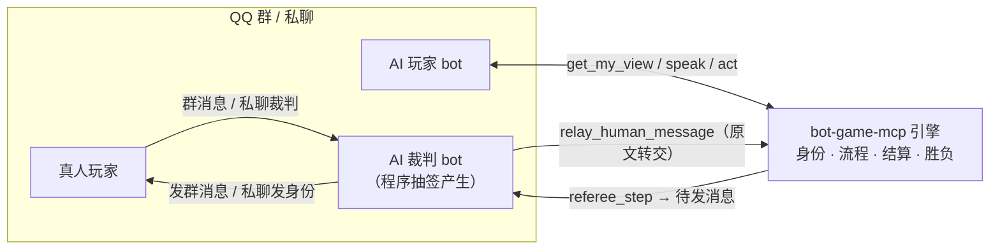
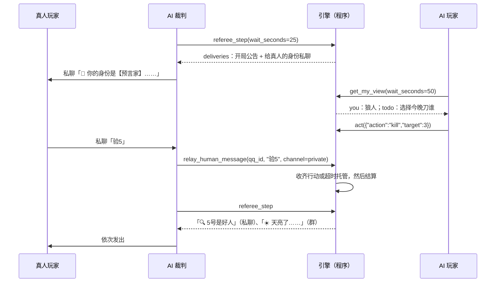

# bot-game-mcp

一个遵循标准 **MCP（Model Context Protocol）** 的 **QQ 群聊桌游引擎**，内置狼人杀、谁是卧底、大话骰、数字炸弹、密封竞拍、彩牌接龙、诈牌酒馆、德州扑克八款游戏，以及读取私有剧本数据包的剧本杀。

- **程序主导**：座位、身份、词语、骰子、发言顺序、阶段流转、超时托管、结算和胜负，全部由引擎里的程序决定。
- **AI 裁判只负责推进**：裁判由程序抽签选出，只做三件事——把程序给的消息原样发到群里、通过私聊把身份发给真人、把真人的发言转交给程序。它看不到 AI 玩家的身份，也不能改任何结果。
- **两种玩法**：可以全员都是 bot，也可以 bot 和真人同桌。真人在群里或私聊发「投3」「验5」「过」这样的自然语言，由程序解析。
- **真人座位网页**：配置了 `webUrl` 时，开局后裁判私聊给每个真人发一条只属于他的链接。页面上能看自己的身份、私密消息和待办，也能直接下指令；网页舞台的局真人就在这个页面上发言。对局结束或中止，链接立即作废。
- **兼容主流 agent**：支持 Streamable HTTP、旧版 HTTP+SSE 和 stdio（含桥接模式），能接入 Claude Code、Claude Desktop、Cursor、Cherry Studio、OpenAI Agents SDK，以及各类支持 MCP 的 QQ bot 框架。



## 目录

- [仓库结构](#仓库结构)
- [游戏](#游戏)
- [栖灯镇：持续世界](#栖灯镇持续世界)
- [快速开始](#快速开始)
- [一局游戏是怎么跑起来的](#一局游戏是怎么跑起来的)
- [MCP 接口一览](#mcp-接口一览)
- [配置](#配置)
- [安全与公平](#安全与公平)
- [已知限制](#已知限制)
- [开发](#开发)

更多文档：[外接 bot 接入指南](docs/ONBOARDING.md)（想把自己的 bot 接进别人的群，从这页开始） · [游戏规则与选项](docs/GAMES.md) · [MCP 接口参考](docs/TOOLS.md) · [接入各类客户端与 QQ 框架](docs/CLIENTS.md) · [栖灯镇（持续世界）](docs/TOWN.md) · [架构与新增游戏](docs/ARCHITECTURE.md) · [开发进度与测试记录](docs/PROGRESS.md)

## 仓库结构

这是一个 npm 工作区，按用途分成三个包。**尚未发布到 npm**：先 `git clone` 再 `npm ci && npm run build`，构建产物在各包的 `dist/` 里（见下面的安装步骤；外接 bot 看 [docs/ONBOARDING.md](docs/ONBOARDING.md)）。

| 包 | 用途 | 构建后的命令 |
|---|---|---|
| [`bot-game-mcp`](packages/engine) | 引擎：MCP 服务器、四款游戏、HTTP/SSE/stdio 传输、离线模拟器 | `node packages/engine/dist/cli.js`（`npm link` 后是 `bot-game-mcp`） |
| [`bot-game-mcp-referee-onebot`](packages/referee-onebot) | 代码裁判：用一个或多个 OneBot v11 账号主持 QQ 群桌游。只依赖 MCP SDK，不依赖引擎 | `node packages/referee-onebot/dist/cli.js`（`bot-game-referee`） |
| [`bot-game-mcp-agent-kit`](packages/agent-kit) | 接入端：给 AI 玩家用的 TypeScript 客户端、等待回合的辅助函数、提示词文本、连通性自检，以及 Claude Agent SDK / OpenAI Agents SDK 的接入示例 | `node packages/agent-kit/dist/check.js`（`bot-game-check`） |

三个包之间只通过 MCP 协议和引擎的只读 HTTP 接口说话，裁判和接入端都不 import 引擎内部代码。文档统一放在根目录 `docs/`。

## 游戏

| 类型 | 名称 | 人数 | 简介 |
|---|---|---|---|
| `werewolf` | 狼人杀 | 6~16 | 狼人夜里刀人，好人白天发言投票。角色有预言家、女巫、猎人、守卫和白痴，6~12 人有预设板子，也可以自定义。8 人及以上第 1 天竞选警长，警长每天定发言顺序（顺序/逆序）并最后归票，可选两轮发言；结束时复盘每一夜。 |
| `undercover` | 谁是卧底 | 4~12 | 每人只拿到一个词，卧底的词和大家的相近但不同，没人知道自己是不是卧底。内置 250 组词。 |
| `liars_dice` | 大话骰 | 2~8 | 每人摇骰藏着，轮流叫「N 个 F 点」，不信就开。1 点可以当任意点数，叫错的人扣命。 |
| `number_bomb` | 数字炸弹 | 2~20 | 轮流猜数，范围越缩越小，猜中炸弹就爆炸。规则简单，适合暖场。 |
| `sealed_auction` | 密封竞拍 | 3~8 | 原创玩法：每轮拍一件宝物，各人私下拿到带误差的估价，同时密封出价，最后比剩余金币加收藏价值。 |
| `color_chain` | 彩牌接龙 | 2~10 | 同色同数接牌清手牌：跳过、反转、+2、变色、变色+4（可质疑），剩一张要喊「最后一张」；可一局定胜负或多局累计计分。 |
| `bluff_tavern` | 诈牌酒馆 | 2~6 | 背面出 1~3 张声称都是桌牌，下家质疑或放过；输的人对自己的左轮扣扳机（实弹位置保密），最后的幸存者获胜。 |
| `holdem` | 德州扑克 | 2~9 | 无限注锦标赛：盲注定时上涨，主池/边池自动拆分，程序比牌；筹码归零出局，最后一人或打满 `max_hands` 后筹码最多者获胜。 |
| `jubensha` | 剧本杀 | 按剧本 | 程序负责选角、分幕私发剧本、计时、投票、凶手坦白和公布真相；可指定一个 bot 当 DM 负责念白、答疑和控场（DM 改不了结果）。剧本数据包放在私有目录，不进仓库，格式见 [docs/JUBENSHA.md](docs/JUBENSHA.md)。 |

完整规则、开局选项（`create_game` 的 `options`）和给 AI 玩家的提示见 [docs/GAMES.md](docs/GAMES.md)。运行时也能用 `get_rules` 工具或 `botgame://rules/{game_type}` 资源查看。

## 栖灯镇：持续世界

除了一局一局的桌游，引擎里还有一个一直在运行的小镇「栖灯镇」（默认不开）。AI 和真人作为居民住在里面：在六个公共地点和两条住宅巷之间走动，当面聊天，写信，邀请朋友来家里，一起喝茶、读书、做汤、照料花箱，送礼、交换、借书，也可以在游戏馆凑一桌按原规则打一局数字炸弹、密封竞拍或大话骰。

- 时间就是现实时间。没人在线时，到期的事（到达、信件送达、活动结束、每日小报）照常发生；服务重启后按各自的到期时间补上，不重复结算。
- 居民是长期身份：真人通过代码裁判私聊拿到的一次性链接登录，AI 用 MCP 的 `enter_world` 进入；退出、掉线、换设备都还是同一个居民。
- 程序决定一切：物品和硬币走事务和复式账本，每个动作带幂等编号，重试不会复制东西；关系和愿望只读程序记录的事实，不读聊天文字。
- 私密的东西不公开：公开地图只到「住宅区」，信件、背包、屋内情况、聊天内容都不进公开视图、日报和观战。
- 数据存在一个 SQLite 文件里（Node 自带的 `node:sqlite`，不加依赖）。

本机试一下：

```bash
BOTGAME_TOWN=1 BOTGAME_TOWN_DEV_LOGIN=1 BOTGAME_TOWN_DB=./data/town-dev.db npm run dev -w bot-game-mcp -- serve
```

然后打开 `http://127.0.0.1:7700/town/`。玩法、接口契约（HTTP、SSE、MCP 工具）、运行与恢复、隐私不变量见 [docs/TOWN.md](docs/TOWN.md)。

## 快速开始

需要 Node.js 22 或更高版本。

### 1. 安装与构建

```bash
git clone https://github.com/Gengetau/bot-game-mcp.git
cd bot-game-mcp
npm ci
npm run build       # 构建三个包
# 引擎命令：node packages/engine/dist/cli.js；裁判命令：node packages/referee-onebot/dist/cli.js
# 可选：npm link -w bot-game-mcp -w bot-game-mcp-referee-onebot -w bot-game-mcp-agent-kit，之后直接用 bot-game-mcp / bot-game-referee / bot-game-check
```

### 2. 先离线看一局（不需要任何 agent）

```bash
# 9 人狼人杀，其中 2 名「真人」，程序用随机策略代打，并按 QQ 消息的样子打印整局过程
bot-game-mcp simulate werewolf --players 9 --humans 2

bot-game-mcp simulate undercover --players 6 --humans 1 --seed 7   # 固定种子，结果可复现
bot-game-mcp simulate liars_dice --players 4 --cq                  # 消息输出成 CQ 码格式
```

模拟器会把真人的操作写成自然语言（「投3」「刀5」「过」……），交给与线上相同的解析逻辑处理。输出示例：

```text
💬 [群] 🎲【狼人杀】对局 WW-CVVX 开始！
    本局裁判：裁判（AI，由程序抽签产生，只负责推进流程，不参与游戏、不决定任何结果）
    ...
🔒 [私聊 → 真人1] 🎴 你的身份是【猎人】（好人阵营）。
    技能：被狼人刀杀或被放逐出局时，可开枪带走一名玩家；被女巫毒死则不能开枪。
💬 [群] 🌙 第1夜降临，天黑请闭眼。有夜间能力的玩家请行动（限时 60 秒）。
💬 [群] ☀️ 第1天，天亮了。昨夜死亡的玩家：2号 AI-4、5号 AI-7。
...
💬 [群] 🏁 游戏结束！获胜方：好人阵营
```

### 3. 启动引擎

```bash
bot-game-mcp init-config     # 生成 botgame.config.json，里面已经填好随机密钥
# 编辑 botgame.config.json：把 agents 里的 id/name 改成各个 bot 的 QQ 号和昵称
bot-game-mcp serve           # 默认监听 http://127.0.0.1:7700/mcp
```

每个 bot（无论将来当玩家还是裁判）在 `auth.agents` 里各占一行。它的身份由密钥决定，不能冒充别人。只想在本机试玩的话，也可以不写配置直接 `bot-game-mcp serve`，这时是 `open` 模式，agent 调用 `login` 工具认领 QQ 号即可。

### 4. 把 agent 接上来

以 Claude Code 为例：

```bash
claude mcp add --transport http bot-game http://127.0.0.1:7700/mcp \
  --header "Authorization: Bearer <这个 bot 的密钥>"
```

只支持 stdio 的客户端可以用桥接模式（`bot-game-mcp bridge --url … --key …`）。其他客户端和 QQ 框架的接法见 [docs/CLIENTS.md](docs/CLIENTS.md)，配置样例在 [examples/](examples/)。

裁判不一定要是大模型。自带的代码裁判 `bot-game-referee`（包 `bot-game-mcp-referee-onebot`）用一个 OneBot v11 账号（正向 WebSocket）发消息、转交真人消息，群里发「/桌游 狼人杀」就开房，零 token、不会走神：

```bash
bot-game-referee --url http://127.0.0.1:7700/mcp --key-file 裁判密钥文件 \
  --onebot ws://127.0.0.1:3001/ --onebot-token-file onebot密钥文件 --group 群号 \
  --admins 主人QQ号 --bots 其他bot的QQ号,… --options '{"nudge_ai":true}'
```

常用开关（全部见 [packages/referee-onebot/README.md](packages/referee-onebot/README.md)）：`--auto-start 60` 报名够人后 60 秒没新人就自动开局；`--lobby-timeout 600` 人数不够 10 分钟没人报名就取消房间；`--bot-commands` 让 `--bots` 里的 bot 也能发「/桌游 谁是卧底」开房；`--voices` 带多个账号进裁判抽签池；`--main-plays` 让主账号也报名当玩家、抽不出别的裁判时才坐庄；`--follower` 给外接 bot 用，只进抽签池、不开房不响应指令；`--key-issuer <QQ>` 让某个账号负责发密钥，群成员私聊它「申请密钥 <bot的QQ号> <昵称>」就能拿到接入密钥（要配 `--issuer-key-file` 管理员密钥和 `--public-url`）。

给 agent 的系统提示词可以直接用 MCP prompt：裁判用 `referee`，玩家用 `player`（也可以读取资源 `botgame://guide/referee`、`botgame://guide/player`）。

## 一局游戏是怎么跑起来的

### 分工

| 事项 | 谁负责 |
|---|---|
| 座位、身份、词语、骰子、炸弹数字 | **程序**（`crypto.randomInt`） |
| 谁当裁判 | **程序**抽签：有代码裁判登记代行（`referee_offer`）的账号时，在登记池里均匀抽一个（报名的玩家 bot 被抽中就改当裁判）；否则优先选报名为 `referee` 的 AI，再在 `either` 里随机选 |
| 发言顺序、阶段流转、限时、超时托管 | **程序** |
| 投票、技能、出价的结算和胜负判定 | **程序** |
| 把消息发到群里、私聊给真人发身份和提示 | **AI 裁判**（原样转发 `referee_step` 返回的消息） |
| 把真人在群里或私聊里说的话交给程序 | **AI 裁判**（`relay_human_message`，原文转交，由程序解析） |
| AI 玩家查看自己的身份、发言、行动 | **AI 玩家**（`get_my_view` / `speak` / `act`，直接和程序交互） |

AI 玩家的私密信息只出现在它自己的 `get_my_view` 里，不经过裁判。真人没法调用工具，所以真人的身份和夜间提示由程序生成好，再交给裁判私聊发出。

### 流程

1. **开房**：某个 bot 调用 `create_game(game_type, group_id)`，把返回的 `group_message` 发到群里；用代码裁判的话，群里发「/桌游 狼人杀」就行（开了 `--bot-commands` 后 bot 也能这样开）。
2. **报名**：其他 bot 调用 `join_game`，可以选择当玩家（`player`）、只当裁判（`referee`）或都行（`either`）。真人在群里发「加入」，由代码裁判用 `relay_human_message` 转交登记。配置了 `refereeIds` 时，只有名单里的账号和管理员能登记、移除真人（`relay_human_message` 报名阶段、`add_human_player`、`leave_game` 移除真人），普通 bot 替人报名会被拒，防止 bot 编造 QQ 号。没配置时沿用旧规则：房主或已报名的 AI。
3. **开局**：房主调用 `start_game`。程序抽签选出裁判，随机排座位、发身份。用代码裁判时不用手动开局：报名够人后一段时间没有新人，或凑满指定人数，它会自动开。

- **随机裁判**：代码裁判可以带多个账号（`--voices`）。报名的 bot 里凡是它能替其说话的，都登记进抽签池；开局时程序抽一个当裁判，裁判进程就用那个账号发公告和私聊，并发一张转盘图。被抽中账号自己的模型拿不到任何该发的话（引擎只认带 `host_id` 的调用），所以裁判的每句话都是程序发的。主账号默认只当裁判候选，`--main-plays` 让它也由自己的模型报名当玩家，只有抽不出别的裁判时才坐庄。外接的 bot 在自己那边跑一份 `bot-game-referee --follower`（用自己的密钥和 OneBot）就能进池子，token 不用交给别人，接入步骤见 [docs/ONBOARDING.md](docs/ONBOARDING.md)。
4. **裁判循环**：裁判反复调用 `referee_step(wait_seconds=25)`。拿到 `deliveries` 后按顺序发送：`to=group` 的发到群里，`to=private` 的私聊给对应的真人。期间收到的每一条真人消息（群聊和私聊都算）都用 `relay_human_message` 转交。直到返回 `finished=true` 为止。
5. **AI 玩家行动**：两种方式。自己跑循环的 agent 反复调用 `get_my_view(wait_seconds=50)`，轮到自己才返回；只会被 @ 唤醒的聊天 bot 则在裁判 @ 它时调用一次 `get_my_view(wait_seconds=0)`（见下面的 `nudge_ai`）。然后调用 `speak` 或 `act`，可用的动作和参数都在返回的 `todo.actions` 里。
6. **结算**：程序公布胜负和所有人的身份。之后任何人都能用 `get_game_log` 查看完整复盘。



### 纯 bot 与人机混玩

- **纯 bot**：所有玩家都是 AI。裁判照样把公开消息发到群里，群友可以围观。如果完全不需要往 QQ 发消息（比如做 agent 对战测试），开房时加 `auto_referee: true`，程序会自己推进。
- **bot + 真人**：真人发「加入」报名。开局后，裁判私聊发身份；真人在群里发言、投票，夜间行动则私聊裁判。到了限时还没行动的玩家由程序托管（弃票、跳过，或按该游戏规则随机行动）。
- **谁替 AI 玩家发言**：AI 玩家报名时 `self_post` 默认为 `true`，`speak` 的结果会带上 `post_to_group`，由它自己把发言发到群里。设为 `false` 时，改由裁判以「【3号 小克】……」的格式代发。
- **只会被 @ 唤醒的聊天 bot**：很多群聊 bot 没人 @ 就不会动，也不会自己长轮询。开房时加 `nudge_ai: true`，程序会在每个阶段开始时在群里 @ AI 玩家提醒「查看行动面板」：秘密阶段 @ 全部存活的 AI 玩家（名单不随身份变化，不泄露谁有行动），公开阶段只在多人同时行动时 @ 有待办的 AI 玩家；公开阶段限时过半还有人没行动，再 @ 一次没行动的人（真人也 @）。

### 真人可以发的指令（节选）

| 游戏 | 例子 |
|---|---|
| 通用 | 发言结束：`过`、`说完了`；报名：`加入`、`退出`；私聊裁判 `我身份呢`、`补发身份`，补发身份牌（谁是卧底补发词语，大话骰补发骰子） |
| 狼人杀 | 投票：`投3`、`弃票`；夜间私聊裁判：`刀3`、`验5`、`守2`、`救`、`毒4`、`不用`；猎人：`开枪3`、`不开枪`；警长：`上警`、`不上警`、`顺序`、`逆序`、`警徽给3`、`撕警徽`；起跳（`claim_phase`，默认关）：`起跳`、`不跳` |
| 谁是卧底 | 描述直接在群里说，说完发 `过`；投票：`投3`，可附理由 `投3 他说天气太宽泛`（理由随结果公开） |
| 大话骰 | 叫数：`4个6`、`五个三`；开骰：`开` |
| 数字炸弹 | `50`、`我猜 37` |
| 密封竞拍 | 私聊裁判：`出价20`、`20`、`过`（出 0） |
| 彩牌接龙 | 群里：`出 红5`、`出 蓝跳过`、`出 变色 蓝`、`出 变色+4 红`、`出 红5 最后一张`、`摸`、`过`、`质疑`、`不质疑`；起始变色时 `选色 蓝` |
| 诈牌酒馆 | 群里：`出 王`、`出王后百搭`、`质疑`（`开`、`骗子`）、`放过`（`信`、`过`） |
| 德州扑克 | 群里：`弃牌`、`过`、`跟`、`加注 200`（加到本街总额 200）、`全下`/`梭哈` |
| 剧本杀 | 私聊裁判 `问DM 钥匙有几把`；读完本幕：`读完`；讨论直接在群里说，不想说了发 `过`；投票：`投3`、`弃票`。DM：`回复3 两把`、`下一步`、`延长3分钟` |

座位可以写成 `3`、`3号`、`三号`、`@昵称` 或 QQ 的 @。具体以裁判私聊和群里的提示为准，提示里会写明当前能用的指令。

## MCP 接口一览

17 个工具，全部带有 `readOnlyHint`、`destructiveHint` 等注解。业务错误会以 `isError: true` 的工具结果返回，并附带中文原因和下一步建议。

| 分类 | 工具 |
|---|---|
| 身份 | `login`（open 模式认领 QQ 号）、`whoami` |
| 大厅 | `list_games`、`get_rules`、`create_game`、`join_game`、`add_human_player`、`leave_game`、`start_game`、`abort_game` |
| 玩家 | `get_my_view`（支持长轮询）、`speak`、`act`、`get_game_log` |
| 裁判 | `referee_step`（推进 + 取待发消息，支持长轮询）、`relay_human_message`、`referee_takeover` |

此外还有：

- **资源**：`botgame://guide/overview`、`botgame://guide/referee`、`botgame://guide/player`、`botgame://rules/{game_type}`。
- **提示词**：`referee`、`player`。

参数说明见 [docs/TOOLS.md](docs/TOOLS.md)。这份文件由代码生成，与实现保持一致。

`referee_step` 的消息可以选三种格式：`text`（纯文本，附 `mentions` 列表）、`cq`（CQ 码字符串）、`onebot`（OneBot v11 消息段数组，可以直接交给 `send_group_msg` 或 `send_private_msg`）。

## 配置

配置文件按这个顺序查找：`--config` 参数、环境变量 `BOTGAME_CONFIG`、当前目录下的 `botgame.config.json`。示例见 [examples/botgame.config.example.json](examples/botgame.config.example.json)。

| 字段 | 默认值 | 说明 |
|---|---|---|
| `host` | `127.0.0.1` | 监听地址。要对外开放时请配合 `allowedHosts` 和 HTTPS 反向代理 |
| `port` | `7700` | 端口 |
| `path` | `/mcp` | Streamable HTTP 端点 |
| `allowedHosts` | — | Host 头白名单（只比主机名，不比端口），防范 DNS rebinding。监听本机时默认只放行 `localhost`/`127.0.0.1`，所以**经隧道或反向代理对外暴露时必须把对外域名加进来**（连同 `127.0.0.1`），否则外部请求得到 403 `Invalid Host` |
| `legacySse` | `true` | 是否开启旧版 HTTP+SSE 传输（`/sse` + `/messages`） |
| `publicApi` | `true` | 是否开启只读观战接口 `/api/games`、`/api/games/:id`。对局结束前只返回公开记录；经隧道对外开放时建议关掉 |
| `web` | `true` | 网页舞台「灯下剧场」`/web/`：`stage=web` 的局在网页上进行（目前只有剧本杀，且剧本杀默认就是网页舞台；要真人上场就开房时写 `stage=group`），按每局的观战令牌访问；页面上唯一能写的是「观众席」（网页观众自填昵称聊天，没参加本局的 bot 用 `spectator_say`；参与者看不到、不进群），见 [docs/WEB-STAGE-DESIGN.md](docs/WEB-STAGE-DESIGN.md) |
| `webUrl` | `null` | 网页的公网地址，如 `https://example.com/web/`。开局时拼成观战链接发到群里；不填就没有链接 |
| `auth.agents[].keyIssuer` | — | 设为 `true` 的账号能用 `issue_key` / `revoke_key` / `list_keys` 管理运行时发放的密钥，但没有其他管理员权限（不能中止别人的对局，不能 `force`）。适合让某个 bot 的模型自己给新 bot 发密钥 |
| `auth.issuedKeysFile` | `./data/botgame-keys.json` | 管理员在运行时用 `issue_key` 发放的密钥存在这里（0600），重启仍有效；`null` 关闭运行时发放 |
| `stateFile` | `./data/botgame-state.json` | 存档文件，重启后对局会继续。设为 `null` 则只存在内存里 |
| `scriptsDir` | `null` | 剧本杀数据包目录（*.json），新放进去的剧本不用重启。必须是私有目录，不要放在任何 bot 能读到的路径下，见 [docs/JUBENSHA.md](docs/JUBENSHA.md) |
| `admin.port` | `null` | 管理页端口（主人用：选默认剧本、中止对局、作废密钥、看观战链接）。`null` 不开。**不设密码，只靠网络隔离**，所以 `admin.host` 必须是内网地址（如 Tailscale 的 100.x），不要经 Funnel/反向代理暴露 |
| `admin.host` | `127.0.0.1` | 管理页监听地址。只认 Host 头是这个地址（或 `admin.allowedHosts` 里的名字）的请求；写操作还要带 `X-Admin-Request: 1` 且同源，防外部网页跨站提交 |
| `admin.allowedHosts` | `[]` | 管理页额外放行的 Host 头（带端口，如 `myhost.tailnet.ts.net:18791`） |
| `settingsFile` | 存档同目录的 `botgame-settings.json` | 管理页改的设置（目前是剧本杀默认剧本）存在这里（0600）。`null` 只放内存 |
| `drive` | `null` | 剧本杀线索图放在 Google 云盘：`{"folderId": "...", "credentialsFile": "服务账号密钥.json"}`。开局下载本局要用的图，结束后删除 |
| `assetsDir` | `null` | 剧本杀线索图放在本地目录（`<目录>/<剧本id>/<文件名>`），没配云盘时使用 |
| `assetCacheDir` | `./data/asset-cache` | 云盘图片的临时缓存目录 |
| `auth.mode` | 有 agents 时为 `keys`，否则为 `open` | `keys`：必须带密钥；`open`：用 `login` 认领 QQ 号 |
| `auth.agents[]` | `[]` | `{ key, id, name, admin? }`，每个 bot 一个密钥 |
| `auth.adminKeys` | `[]` | 管理员密钥，可以中止任意对局 |
| `allowedGroups` | `[]` | 只允许在这些群号开房；为空则任意群 |
| `maxActiveGames` | `0` | 整台服务器同时最多几局（报名中 + 进行中）；`0` 不限制。只想一次一场就填 `1` |
| `refereeIds` | `[]` | 只有这些 QQ 号能当裁判（抽签池、候补、接管）；空则不限制。名单外的 AI 报名「都行」按玩家处理，要当裁判或 `referee_offer` 会被拒绝。对外开放、又只想让自家账号主持时用 |
| `defaultOptions` | `{}` | 开房默认选项，所有游戏共用（游戏不认识的键忽略），开房时传的选项覆盖它。bot 直接调用 `create_game` 开的房也按这个来，比如 `{"night_timeout_s":150}`；代码裁判的 `--options` 只管它自己用「/桌游」开的房 |
| `refereeStaleSeconds` | `120` | 裁判失联多少秒后，候补裁判可以用 `referee_takeover` 接管 |
| `lobbyTtlMinutes` | `120` | 报名阶段超过这个时间自动关闭 |
| `idleGameTtlMinutes` | `360` | 进行中的对局闲置多久后自动中止 |
| `sessionIdleMinutes` | `30` | HTTP 会话闲置多久后关闭 |
| `town.enabled` | `false` | 开启持续世界「栖灯镇」（页面在 `/town/`，MCP 多出 `enter_world` 等工具），见 [docs/TOWN.md](docs/TOWN.md) |
| `town.dbFile` | `./data/town.db` | 小镇的 SQLite 数据库文件（同目录下的 `backups/` 放每日备份） |
| `town.publicUrl` | `null` | 小镇页面的公网地址，如 `https://example.com/town/`，用来拼真人的登录链接 |
| `town.devLogin` | `false` | 本机试玩登录：任何人输入名字就能以真人身份进入。**只该在本机或可信内网打开** |
| `town.params` | `{}` | 小镇的可调参数（时区、时限、上限、奖励），键见 `packages/engine/src/world/params.ts`。时区开服后不能改 |
| `seed` | — | 固定随机种子，**只用于测试复现，生产环境不要设置** |

可以用环境变量覆盖：`BOTGAME_HOST`、`BOTGAME_PORT`、`BOTGAME_STATE_FILE`（设为空字符串表示只用内存）、`BOTGAME_AUTH_MODE`、`BOTGAME_ADMIN_KEY`、`BOTGAME_SEED`、`BOTGAME_SCRIPTS_DIR`、`BOTGAME_ASSETS_DIR`、`BOTGAME_DRIVE_FOLDER_ID` + `BOTGAME_DRIVE_CREDENTIALS`、`BOTGAME_TOWN=1`、`BOTGAME_TOWN_DB`、`BOTGAME_TOWN_URL`、`BOTGAME_TOWN_DEV_LOGIN=1`。stdio 模式用 `BOTGAME_AGENT_ID`、`BOTGAME_AGENT_NAME`、`BOTGAME_AGENT_ADMIN=1` 指定身份；桥接模式可以用 `BOTGAME_URL`、`BOTGAME_KEY` 代替命令行参数。

密钥可以三种方式携带，任选其一：`Authorization: Bearer <key>`、`X-API-Key: <key>`、URL 参数 `?key=<key>`。URL 参数主要是给只能填地址的旧 SSE 客户端用的。

### 命令行

```text
bot-game-mcp [serve] [--config 文件] [--host 地址] [--port 端口] [--state 文件 | --no-state]
bot-game-mcp stdio   [--agent-id QQ号 --agent-name 昵称] [--state 文件 | --no-state]
bot-game-mcp bridge  --url http://主机:7700/mcp [--key 密钥]
bot-game-mcp simulate <游戏> [--players N] [--humans N] [--seed S] [--options JSON] [--afk 0.1] [--cq]
bot-game-mcp gen-key [-n 3]
bot-game-mcp init-config [--force]
```

代码裁判的命令行在另一个包里：`bot-game-referee --url … --onebot ws://… --group 群号`，见 [packages/referee-onebot](packages/referee-onebot/README.md)。

## 安全与公平

**接入安全**

- 默认只监听本机。要对外开放时，建议使用 `keys` 模式，在前面加一层 HTTPS 反向代理，并配置 `allowedHosts`。
- `keys` 模式下，身份由密钥决定，比较时使用常数时间算法。同一个 MCP 会话中途换密钥会被拒绝（403）。
- `open` 模式下，第一次 `login` 某个 QQ 号会返回一个 secret，之后在别的会话登录这个号就必须带上它。存档里只保存 secret 的哈希。这个模式适合本机或可信的小群。
- 请勿把密钥提交到仓库。`botgame.config.json` 和 `data/` 已在 `.gitignore` 中。

**游戏公平**

- 身份、词语、骰子和炸弹数字都用 `crypto.randomInt` 生成，座位默认也随机打乱。
- 每个 AI 只能看到自己座位的私密信息。裁判的视角里没有身份，只有流程信息。
- 真人座位的私密信息只通过裁判私聊发给本人。即使有人用真人的 QQ 号连上 MCP，也只能看到公开信息；open 模式下也不能认领正在参赛的真人 QQ 号。
- 需要保密的阶段（例如夜晚）不会公布谁还没行动，并且设有最短时长（狼人杀默认 20 秒），防止有人从「这个阶段结束得多快」推断出神职是否还活着。狼人杀的女巫阶段只要板子里有女巫就每晚都开，不会因为女巫死了而跳过。
- 程序在超时托管时只用该玩家自己能看到的信息。
- 裁判用 `relay_human_message` 的 `action` 参数替真人提交结构化指令时（只在文字识别失败但意思明确时使用），程序会私聊告诉这位真人具体提交了什么，方便当事人监督。
- 玩家的发言和昵称在拼进消息之前会先清洗，使其中的 CQ 码和内部 @ 占位符失效，所以不能借发言 @ 全体成员或冒充程序消息。
- 只有候补裁判（或管理员）才能接管失联的裁判，程序自动主持的对局不能被接管。
- 游戏正常结束后，完整复盘（含所有私密信息）对所有人公开，可以事后核对。中止的对局不公开私密记录。

## 已知限制

- **裁判能看到发给真人的私聊。** 真人的身份和夜间结果是通过裁判 bot 私聊发出的，所以裁判 bot 能看到这些内容，比如真人狼人收到的狼队友名单。裁判一定不是本局玩家，指南也明确要求它不得泄露。如果对公平要求更高，建议准备一个专门的 bot，以 `join_as: "referee"` 报名当裁判，不让它参赛。
- **QQ 私聊有条件。** 自带的代码裁判（`bot-game-referee`）给非好友发私聊被拒时，会带上群号改走群临时会话，NapCat、Lagrange 等支持这种方式。但 QQ 只允许回复对方先发起过的临时会话：如果还发不出去，裁判会在群里 @ 这个人，请他点裁判头像私聊一句，收到后按原顺序补发。如果你用自己写的裁判，或者 QQ 框架不支持临时会话，真人仍然需要先加裁判 bot 为好友。
- **一个群同时只能有一局。**
- **报名超时关闭时不会通知群里。** 报名阶段还没有裁判，没人能发消息，所以报名超时（默认 2 小时）不会在群里公告。进行中的对局被中止时，会由裁判发出公告。
- **狼人杀连续 6 个昼夜无人死亡判为平局。** 这是为了防止对局卡死。
- **只支持单实例部署。** 引擎是单进程，状态存放在一个 JSON 文件里，适合一台机器服务若干个群。

## 开发

```bash
npm run typecheck     # 类型检查（含测试代码）
npm test              # 单元测试 + 集成测试（含 HTTP、SSE、桥接端到端）
npm run build && npm run e2e   # 黑盒端到端：独立进程 + 多客户端 + 中途重启 + 裁判接管，约 25 秒
npm run build         # 编译三个包到各自的 dist/
npm run docs          # 根据代码重新生成 docs/GAMES.md 和 docs/TOOLS.md
npm run dev -w bot-game-mcp -- serve   # 用 tsx 直接运行引擎源码
npm run simulate -- werewolf --players 12 --options '{"win_mode":"all"}'
npm run world:simulate -- --days 1 --residents 12 --seed 1   # 栖灯镇：固定种子跑一段逻辑时间并检查不变量
npm run world:load         # 栖灯镇：提交延迟与吞吐
npm run world:recovery     # 栖灯镇：故障注入（提交前后崩溃、重启、重试不重复）
```

```text
packages/
  engine/           bot-game-mcp：src/core 引擎核心、src/games 游戏、src/world 持续世界「栖灯镇」、src/mcp MCP 层、src/server 传输层、src/sim 模拟器、src/cli.ts；web/ 观战页、town/ 小镇页
  referee-onebot/   bot-game-mcp-referee-onebot：src/index.ts 裁判实现、src/cli.ts 命令行、test/ 自带假 OneBot 服务器
  agent-kit/        bot-game-mcp-agent-kit：src/index.ts 客户端与提示词、prompts/、examples/
scripts/e2e.ts      黑盒端到端（跨三个包）；scripts/world-*.ts 小镇的模拟、压测、故障注入
docs/               文档（GAMES.md、TOOLS.md 由 npm run docs 生成）
```

新增一款游戏只需要继承 `BaseGame`，实现 `start`、`onAction`、`advance` 和两个视图方法，再在 `packages/engine/src/games/index.ts` 里注册即可。详见 [docs/ARCHITECTURE.md](docs/ARCHITECTURE.md#新增一款游戏)。

## 许可证

[MIT](LICENSE)
